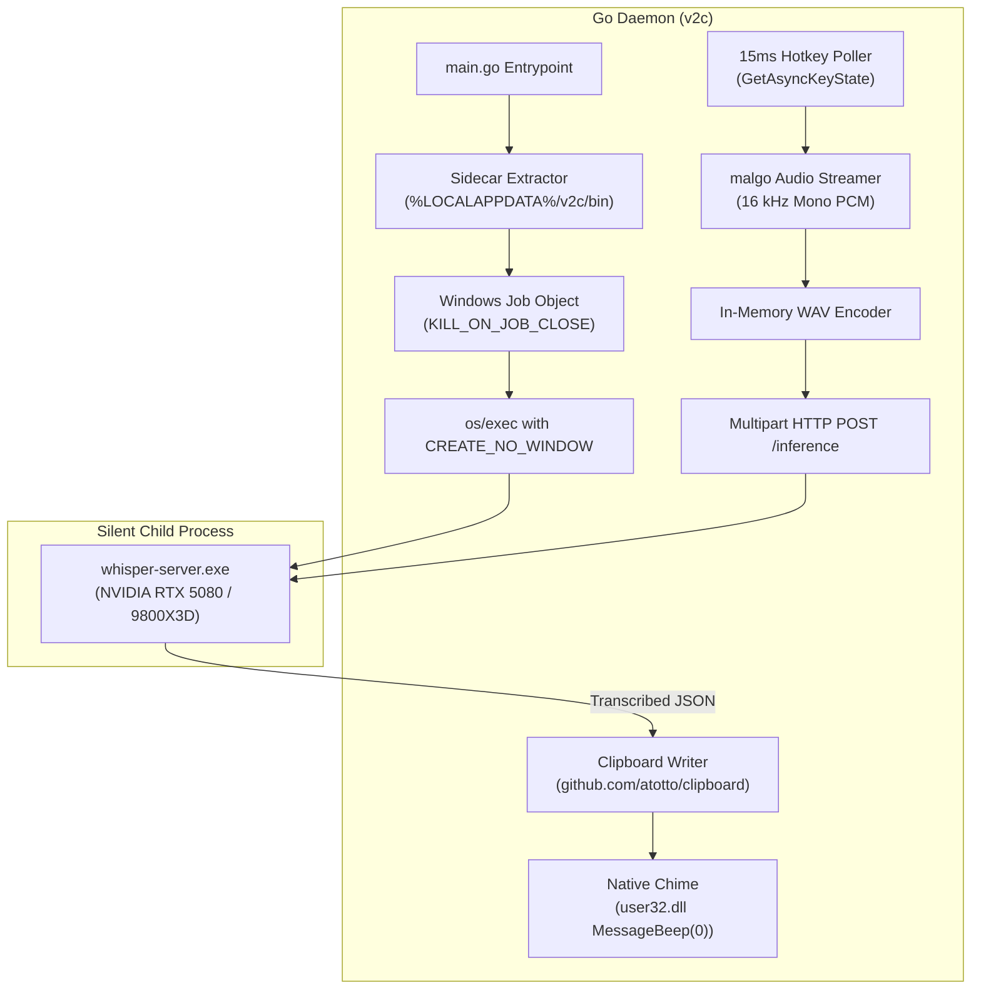

# cliVoiceToClipboard (v2c)

[](https://github.com/nasroht/cliVoiceToClipboard/actions/workflows/ci.yml)
[](LICENSE)
[](https://microsoft.com)
[](https://golang.org)

High-performance Windows 11 voice-to-text clipboard companion written in Go. Operates with a **single-process feel** by managing `whisper.cpp` as an invisible, self-terminating background sidecar.

Hold a push-to-talk key to speak, release to instantly transcribe speech locally on your GPU/CPU, and press **CTRL+V** in World of Warcraft, Discord, or any desktop application to paste your message.

---

## Table of Contents
- [Core Objectives & Single-Process Feel](#core-objectives--single-process-feel)
- [Strict Gaming Policy & Anti-Cheat TOS Compliance](#strict-gaming-policy--anti-cheat-tos-compliance)
- [Hardware Target Optimizations](#hardware-target-optimizations)
- [Silent Sidecar Architecture](#silent-sidecar-architecture)
- [Quick Start Guide](#quick-start-guide)
  - [1. Download Precompiled whisper-server & Weights](#1-download-precompiled-whisper-server--weights)
  - [2. Compile & Run](#2-compile--run)
- [CLI Options & Flags](#cli-options--flags)
- [Supported Hotkeys](#supported-hotkeys)
- [Project Layout](#project-layout)
- [License](#license)

---

## Core Objectives & Single-Process Feel

* **Invisible Sidecar Process**: `whisper-server.exe` launches silently with `CREATE_NO_WINDOW` (0x08000000). No flashing console windows or taskbar icons appear.
* **Windows Job Object Protection**: Child processes are assigned to a Windows Job Object configured with `JOB_OBJECT_LIMIT_KILL_ON_JOB_CLOSE`. If `v2c` is closed, killed via Task Manager, crashes, or receives `SIGINT`, the Windows kernel forcefully kills `whisper-server.exe` immediately—guaranteeing **zero orphan/zombie processes**.
* **Automatic AppData Setup**: Automatically checks and extracts sidecar binaries and models to `%LOCALAPPDATA%/v2c/bin/` on startup.
* **Zero External Cloud Latency**: 100% offline and local inference powered by `whisper.cpp`.
* **Low-Overhead Hotkey Polling**: 15ms ticker utilizing passive `user32.dll!GetAsyncKeyState` (<0.01% CPU usage).
* **Native Audio Notification**: Triggers non-intrusive Windows audio feedback via `user32.dll!MessageBeep(0)` so you know text is ready without looking away from your game.

---

## Strict Gaming Policy & Anti-Cheat TOS Compliance

> [!IMPORTANT]
> **World of Warcraft & Anti-Cheat Safety Guarantee**
> 
> To strictly comply with Blizzard Entertainment policies and gaming anti-cheat systems (Warden, Easy Anti-Cheat, BattlEye, Vanguard):
> 
> 1. **ZERO Keystroke Synthesis**: Does **NOT** call `SendInput`, `keybd_event`, or virtual key injection. You retain 100% manual control over pasting via **CTRL+V**.
> 2. **NO Window Hooks**: Does **NOT** install global Windows message hooks (`SetWindowsHookEx`) or intercept application input queues.
> 3. **NO Game Process or Memory Interaction**: Never inspects, opens handles to, or reads process memory from any game.
> 4. **Standard Windows Subsystems Only**: Only queries the hardware keyboard state for its own assigned trigger key, captures audio via Windows WASAPI (`malgo`), and writes text to the standard Windows clipboard.

---

## Hardware Target Optimizations

| Hardware | Target Role | Flags & Tuning |
| :--- | :--- | :--- |
| **NVIDIA GeForce RTX 5080** | **Primary GPU (CUDA)** | Blackwell architecture with full layer offloading (`-ngl 99`) for sub-100ms inference latency. |
| **AMD Ryzen 7 9800X3D** | **CPU Fallback (AVX-512)** | Zen 5 3D V-Cache architecture with native AVX-512 vectorization, tuned to 6 dedicated threads (`-t 6`) to prevent gaming frame drops. |

---

## Silent Sidecar Architecture



---

## Quick Start Guide

### 1. Automated Setup (Recommended)

Run the included PowerShell setup script to automatically query the latest `whisper.cpp` release, download the Windows CUDA runtime binaries (with cuBLAS and AVX-512 libraries) into `./bin/`, and fetch the `ggml-base.bin` model into `./models/`:

```powershell
powershell -ExecutionPolicy Bypass -File .\setup.ps1
```

*(Alternatively, you can manually download `whisper-server.exe` and its companion DLLs from the [whisper.cpp Releases page](https://github.com/ggerganov/whisper.cpp/releases) and model weights from [Hugging Face](https://huggingface.co/ggerganov/whisper.cpp/resolve/main/ggml-base.bin)).*

---

### 2. Compile & Run

#### Prerequisites
* Windows 11 (64-bit AMD64)
* Go 1.22+
* C compiler for CGo (`clang` or `gcc` via `winget install MartinStorsjo.LLVM-MinGW.UCRT`)

```powershell
# Compile daemon
go build -o v2c.exe ./cmd/v2c

# Launch with CUDA acceleration (RTX 5080)
.\v2c.exe --backend cuda --model models/ggml-base.bin --hotkey F12

# Launch with CPU fallback (Ryzen 7 9800X3D)
.\v2c.exe --backend cpu --model models/ggml-base.bin --threads 6 --hotkey F12
```

---

## CLI Options & Flags

| Flag | Default | Description |
| :--- | :--- | :--- |
| `--backend` | `cuda` | Inference backend: `cuda` (RTX 5080 with `-ngl 99`) or `cpu` (9800X3D with `-ngl 0 -t 6`). |
| `--model` | `models/ggml-base.bin` | Path or filename of the GGML model weights. |
| `--port` | `8080` | Port for the local whisper server HTTP endpoint. |
| `--hotkey` | `0x7B` | Virtual key code (`0x7B`) or friendly name (`F12`, `CAPSLOCK`, `RALT`, etc.). |
| `--chime` | `true` | Native audio chime (`MessageBeep(0)`) on clipboard copy. |
| `--language` | `auto` | Transcription language code (e.g. `en`, `de`) or `auto`. |
| `--threads` | `6` | Dedicated CPU threads for CPU inference mode. |
| `--server-bin` | `""` | Optional explicit path to `whisper-server.exe`. |
| `--no-server` | `false` | Connect to an existing external whisper server without spawning a sidecar. |

---

## Supported Hotkeys

The `--hotkey` flag supports hexadecimal codes, decimal codes, and human-friendly key names:
* **Function Keys**: `F1` through `F24` (Default: `F12` = `0x7B`)
* **Modifier Keys**: `LALT`, `RALT`, `LCTRL`, `RCTRL`, `LSHIFT`, `RSHIFT`
* **Special Keys**: `CAPSLOCK`, `SPACE`, `TAB`, `PAUSE`, `SCROLLLOCK`, `TILDE` / `GRAVE`
* **Navigation**: `INSERT`, `DELETE`, `HOME`, `END`, `PAGEUP`, `PAGEDOWN`
* **Numpad**: `NUMPAD0` through `NUMPAD9`
* **Mouse Extra Buttons**: `XBUTTON1` (`0x05`), `XBUTTON2` (`0x06`)

---

## Project Layout

```
cliVoiceToClipboard/
├── .github/
│   └── workflows/
│       └── ci.yml                     # Windows CI build & test workflow
├── cmd/
│   └── v2c/
│       └── main.go                    # Entrypoint, flag parsing & orchestrator
├── internal/
│   ├── sidecar/
│   │   ├── process_windows.go         # SysProcAttr (CREATE_NO_WINDOW), Windows Job Object
│   │   ├── extractor.go               # %LOCALAPPDATA%/v2c setup & port check
│   │   └── sidecar_test.go            # Sidecar unit tests
│   ├── audio/
│   │   ├── recorder.go                # MiniAudio (malgo) capture & in-memory WAV encoder
│   │   └── recorder_test.go           # RIFF header verification tests
│   ├── clipboard/
│   │   ├── clipboard.go               # Clipboard writing, sanitization & MessageBeep
│   │   └── clipboard_test.go          # Sanitization tests
│   ├── hotkey/
│   │   ├── listener.go                # Low-overhead 15ms GetAsyncKeyState poller
│   │   └── listener_test.go           # Key parsing tests
│   └── whisper/
│       ├── client.go                  # HTTP multipart client with retry logic
│       ├── client_test.go             # Mock HTTP endpoint test suite
│       ├── process.go                 # Process configuration utilities
│       └── process_test.go            # Flag configuration tests
├── models/
│   └── .gitkeep
├── .gitignore
├── go.mod
├── go.sum
├── LICENSE                            # MIT License
└── README.md
```

---

## License

This project is licensed under the [MIT License](LICENSE).
