# cliVoiceToClipboard (v2c)

[](https://github.com/nasroht/cliVoiceToClipboard/actions/workflows/ci.yml)
[](LICENSE)
[](https://microsoft.com)
[](https://golang.org)

High-performance Windows 11 voice-to-text clipboard companion written in Go.

Hold a push-to-talk key to speak, release to instantly transcribe locally via `whisper.cpp`, and press **CTRL+V** in World of Warcraft or any game or chat client to paste your message.

---

## Table of Contents
- [Core Objective](#core-objective)
- [Strict Gaming Policy & TOS Compliance](#strict-gaming-policy--tos-compliance)
- [Hardware Targets](#hardware-targets)
- [Architecture & Workflow](#architecture--workflow)
- [Quick Start Guide](#quick-start-guide)
  - [1. Download Precompiled whisper-server](#1-download-precompiled-whisper-server)
  - [2. Download Model Weights](#2-download-model-weights)
  - [3. Build and Run v2c](#3-build-and-run-v2c)
- [CLI Options & Flags](#cli-options--flags)
- [Supported Hotkeys](#supported-hotkeys)
- [License](#license)

---

## Core Objective

* **Lightweight Background Daemon**: Sits quietly in the background with negligible CPU/memory overhead.
* **Instant Push-to-Talk (PTT)**: Captures audio only while your assigned key is held down.
* **Zero Cloud Latency / 100% Local**: Processes audio on your local machine using `whisper.cpp`—no subscriptions, external APIs, or latency.
* **Direct to Windows Clipboard**: Transcribed text is cleaned and copied immediately to the Windows clipboard ready for manual pasting with **CTRL+V**.
* **Audio Feedback**: Subtle Windows auditory notification chime (`MessageBeep`) sounds upon completion so you never have to look away from your crosshair or raid frame.

---

## Strict Gaming Policy & TOS Compliance

> [!IMPORTANT]
> **World of Warcraft & Anti-Cheat Safety Guarantee**
> 
> To strictly comply with Blizzard Entertainment policies and gaming anti-cheat systems (Warden, Easy Anti-Cheat, BattlEye, Vanguard), `cliVoiceToClipboard`:
> 
> 1. **NEVER simulates keyboard presses or keystrokes**: There are **zero** calls to `SendInput`, `keybd_event`, or virtual keyboard injection. You retain 100% manual control over pasting via **CTRL+V**.
> 2. **NEVER interacts with game window hooks**: No `SetWindowsHookEx` or intrusive global keyboard hooks that could interfere with game input or trigger security alerts.
> 3. **NEVER touches or reads game memory**: Does not inspect game processes, windows, handles, or memory spaces.
> 4. **Only passive OS interactions**: Reads global hotkey state via passive `GetAsyncKeyState`, streams microphone input via standard Windows WASAPI (`malgo`), and writes text to the standard Windows clipboard.

---

## Hardware Targets

| Hardware | Role | Acceleration & Optimization |
| :--- | :--- | :--- |
| **NVIDIA GeForce RTX 5080** | **Primary GPU Target** | CUDA acceleration offloading all layers (`-ngl 99`) for lightning-fast sub-100ms transcription latency. |
| **AMD Ryzen 7 9800X3D** | **CPU Fallback Target** | Zen 5 3D V-Cache architecture with native AVX-512 instructions, optimized with dedicated worker threads (`-t 8`). |

---

## Architecture & Workflow

```mermaid
flowchart LR
    A["Push-to-Talk Key Held (F12)"] -->|"GetAsyncKeyState"| B["malgo WASAPI Capture"]
    B -->|"In-Memory PCM Buffer"| C["WAV 16kHz Mono Encoder"]
    C -->|"HTTP Multipart POST /inference"| D["whisper-server.exe\n(CUDA RTX 5080 / 9800X3D AVX-512)"]
    D -->|"Transcribed Text"| E["Sanitize & Clean Text"]
    E -->|"github.com/atotto/clipboard"| F["Windows Clipboard"]
    F -->|"MessageBeep (user32.dll)"| G["Auditory Chime (Ding!)"]
    G --> H["User Presses CTRL+V"]
```



1. **PTT Detection**: Background polling loop queries `user32.dll!GetAsyncKeyState` at 100 Hz (~0% CPU).
2. **Audio Capture**: While key is held, `github.com/gen2brain/malgo` streams microphone audio directly into an in-memory PCM buffer.
3. **WAV Serialization**: Upon key release, raw PCM audio is packaged into a standard 16 kHz 16-bit mono RIFF WAVE buffer in RAM.
4. **Local Inference**: Audio buffer is transmitted over HTTP multipart POST to the local `whisper-server` (`/inference`).
5. **Text Sanitization**: Hallucinated Whisper tokens (e.g., `[BLANK_AUDIO]`, `[music]`, `(silence)`) and excessive whitespaces are stripped.
6. **Clipboard & Chime**: The cleaned string is written to the Windows clipboard via `github.com/atotto/clipboard` and an audio chime plays.

---

## Quick Start Guide

### 1. Download Precompiled whisper-server

Precompiled Windows releases of `whisper.cpp` are available directly from the [whisper.cpp Releases page](https://github.com/ggerganov/whisper.cpp/releases):

#### For NVIDIA CUDA Acceleration (RTX 5080, RTX 40/50 series):
Download the CUDA build archive:
* `whisper-cublas-12.x-bin-x64.zip` (or the latest CUDA release).
* Extract `whisper-server.exe` and its accompanying `.dll` files (such as `cublas64_*.dll`, `cudart64_*.dll`, etc.) into your project directory or `bin/`.

#### For CPU AVX-512 Fallback (AMD Ryzen 7 9800X3D / Intel CPUs):
Download the standard Windows 64-bit build archive:
* `whisper-bin-x64.zip`.
* Extract `whisper-server.exe` into your project directory or `bin/`.

---

### 2. Download Model Weights

Download your desired GGML model format from Hugging Face:

| Model | File Size | Recommended Use Case | Download Link |
| :--- | :--- | :--- | :--- |
| **base.en** | ~142 MB | Fastest English transcription, minimal VRAM | [Download ggml-base.en.bin](https://huggingface.co/ggerganov/whisper.cpp/resolve/main/ggml-base.en.bin) |
| **base** | ~142 MB | Multilingual default | [Download ggml-base.bin](https://huggingface.co/ggerganov/whisper.cpp/resolve/main/ggml-base.bin) |
| **small** | ~466 MB | High accuracy for gaming callouts | [Download ggml-small.bin](https://huggingface.co/ggerganov/whisper.cpp/resolve/main/ggml-small.bin) |
| **medium** | ~1.5 GB | Superior multilingual accuracy | [Download ggml-medium.bin](https://huggingface.co/ggerganov/whisper.cpp/resolve/main/ggml-medium.bin) |

Save your downloaded model in the `models/` directory:
```powershell
# Example: Download ggml-base.bin via PowerShell
Invoke-WebRequest -Uri "https://huggingface.co/ggerganov/whisper.cpp/resolve/main/ggml-base.bin" -OutFile "models/ggml-base.bin"
```

---

### 3. Build and Run v2c

#### Prerequisites
* Windows 11 64-bit
* Go 1.22+ installed
* A C compiler for CGo (`gcc` / `clang` via [LLVM-MinGW](https://github.com/mstorsjo/llvm-mingw) or [WinLibs](https://winlibs.com/)):
  ```powershell
  # Install LLVM-MinGW via winget:
  winget install MartinStorsjo.LLVM-MinGW.UCRT
  ```

#### Build
```powershell
# Clone repository
git clone https://github.com/nasroht/cliVoiceToClipboard.git
cd cliVoiceToClipboard

# Compile executable
go build -o v2c.exe ./cmd/v2c
```

#### Run with CUDA (Default, RTX 5080)
```powershell
.\v2c.exe --backend cuda --model models/ggml-base.bin --hotkey F12
```

#### Run with CPU (Ryzen 7 9800X3D AVX-512)
```powershell
.\v2c.exe --backend cpu --model models/ggml-base.bin --threads 8 --hotkey F12
```

---

## CLI Options & Flags

| Flag | Default | Description |
| :--- | :--- | :--- |
| `--backend` | `cuda` | Inference backend: `cuda` (NVIDIA RTX 5080 with `-ngl 99`) or `cpu` (9800X3D AVX-512 with `-ngl 0 -t 8`). |
| `--model` | `models/ggml-base.bin` | Path to the GGML model weights file. |
| `--port` | `8080` | Port for the local `whisper-server` HTTP API. |
| `--hotkey` | `0x7B` | Virtual key code (`0x7B`) or friendly name (`F12`, `CAPSLOCK`, `RALT`, etc.). |
| `--beep` | `true` | Play Windows auditory chime (`MessageBeep`) on completion. |
| `--language` | `auto` | Transcription language code (e.g. `en`, `de`, `fr`) or `auto`. |
| `--server-bin` | `whisper-server.exe` | Path to the `whisper-server` executable. |
| `--no-server` | `false` | Connect to an existing running whisper server without spawning a subprocess. |
| `--threads` | `8` | Dedicated CPU threads when using `--backend cpu`. |

---

## Supported Hotkeys

The `--hotkey` flag accepts hexadecimal virtual key codes, decimal codes, or friendly key names:

* **Function keys**: `F1` through `F24` (Default: `F12` = `0x7B`)
* **Modifier keys**: `LALT`, `RALT`, `LCTRL`, `RCTRL`, `LSHIFT`, `RSHIFT`
* **Special keys**: `CAPSLOCK`, `SPACE`, `TAB`, `PAUSE`, `SCROLLLOCK`, `TILDE` / `GRAVE`
* **Navigation**: `INSERT`, `DELETE`, `HOME`, `END`, `PAGEUP`, `PAGEDOWN`
* **Numpad**: `NUMPAD0` through `NUMPAD9`
* **Mouse Extra Buttons**: `XBUTTON1` (`0x05`), `XBUTTON2` (`0x06`)
* **Hex / Raw**: Any virtual key code (e.g. `0x7B`, `123`)

---

## Project Structure

```
cliVoiceToClipboard/
├── .github/
│   └── workflows/
│       └── ci.yml             # Automated CI build and testing
├── cmd/
│   └── v2c/
│       └── main.go            # Entry point, flag parsing & lifecycle management
├── internal/
│   ├── audio/
│   │   ├── recorder.go        # Malgo audio capture & in-memory WAV encoder
│   │   └── recorder_test.go   # WAV header and duration tests
│   ├── clipboard/
│   │   ├── clipboard.go       # Clipboard writing & hallucination text cleanup
│   │   └── clipboard_test.go  # Sanitization test suite
│   ├── hotkey/
│   │   ├── listener.go        # Windows GetAsyncKeyState polling loop & chime
│   │   └── listener_test.go   # Virtual key parsing tests
│   └── whisper/
│       ├── client.go          # HTTP client for whisper.cpp with retry logic
│       ├── client_test.go     # Client tests with mock endpoints
│       ├── process.go         # Subprocess supervisor for CUDA & CPU backends
│       └── process_test.go    # Argument building tests
├── models/
│   └── .gitkeep               # Model directory
├── .gitignore
├── go.mod
├── go.sum
├── LICENSE                    # MIT License
└── README.md
```

---

## License

This project is licensed under the [MIT License](LICENSE).
